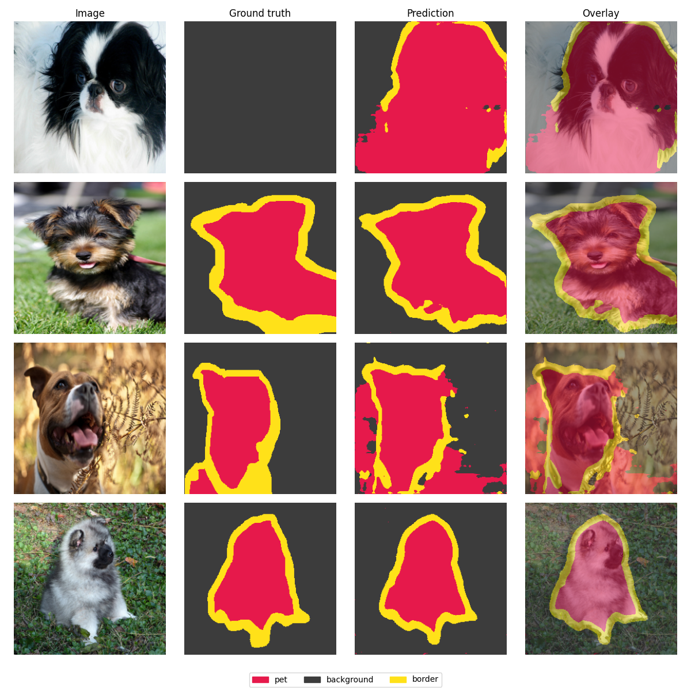
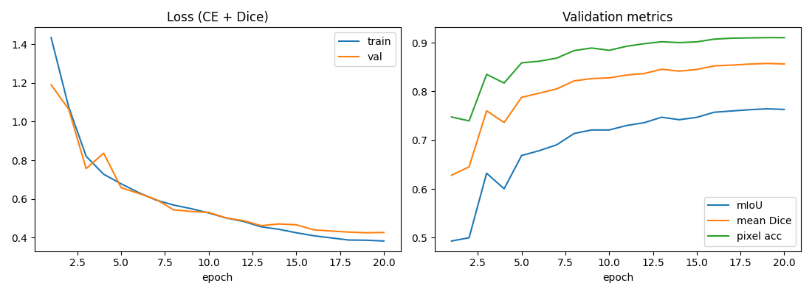

# U-Net Semantic Segmentation (PyTorch)


A from-scratch PyTorch implementation of **U-Net** for multi-class semantic
segmentation, trained on the **Oxford-IIIT Pet** dataset (pet / background / border).
The project covers the full pipeline: data loading with paired image–mask
augmentation, a hybrid **Cross-Entropy + Dice** loss, confusion-matrix based
metrics (**mIoU, Dice, pixel accuracy**), mixed-precision training, and an
inference script for arbitrary images.



## Results

Trained from scratch (no pretrained weights) for 20 epochs at 256×256 on the
3,680 `trainval` images and evaluated on the 3,669 `test` images, using a single
RTX 4060 Laptop GPU (~45 s/epoch, 7.8M parameters).

| Metric (test set)  | Value     |
|--------------------|-----------|
| **Mean IoU**       | **0.764** |
| Mean Dice          | 0.858     |
| Pixel accuracy     | 0.911     |
| IoU – pet          | 0.831     |
| IoU – background   | 0.909     |
| IoU – border       | 0.554     |

The *border* class is a thin band of a few pixels around each animal, which makes it
much harder than the other two classes. That's typical for this dataset.

> Note: in the first row of the prediction grid above, the ground-truth trimap is
> empty, which is a known annotation error in Oxford-IIIT Pet. The model still segments
> the dog correctly.



Reproduce with:

```bash
python train.py --dataset pets --epochs 20 --batch-size 16 --out runs/pets
```

## Features

- **U-Net from scratch** – configurable depth and width, skip connections,
  transposed-conv upsampling, works with arbitrary (non power-of-two) input sizes.
- **Joint augmentations** – flip, rotation and color jitter applied consistently to
  image and mask (bilinear for images, nearest-neighbor for masks so labels stay valid).
- **Dice + CE loss** – cross-entropy for per-pixel accuracy, soft Dice for region
  overlap and robustness to class imbalance.
- **Metrics** – a confusion matrix is accumulated over the whole validation set, then
  per-class IoU, mean IoU, mean Dice and pixel accuracy are derived from it.
- **Training utilities** – AdamW, One-Cycle LR schedule, AMP (float16) on GPU, best
  checkpoint selection by mIoU, loss/metric curves and prediction grids.
- **Synthetic dataset** – a procedurally generated circles-and-rectangles dataset for
  experiments without a download; used in CI as a smoke test.
- **Unit tests + GitHub Actions** – model shapes, loss, metric correctness and an
  overfit-a-tiny-batch sanity check.

## Project structure

```
├── segmentation/
│   ├── model.py        # U-Net (DoubleConv, Down, Up blocks)
│   ├── data.py         # Oxford-IIIT Pet + synthetic shapes datasets, joint transforms
│   ├── losses.py       # Dice and Dice+CE losses
│   ├── metrics.py      # confusion matrix, IoU, Dice, pixel accuracy
│   └── visualize.py    # colorized masks, overlays, training curves
├── train.py            # training / evaluation loop
├── predict.py          # inference on your own images
└── tests/              # pytest unit tests
```

## Getting started

```bash
git clone https://github.com/MehmetAliUSLU/unet-semantic-segmentation.git
cd unet-semantic-segmentation
pip install -r requirements.txt   # install the CUDA build of torch first if you have a GPU
```

### Train

```bash
# Oxford-IIIT Pet (downloaded automatically into ./data, ~800 MB)
python train.py --dataset pets --epochs 20 --batch-size 16 --out runs/pets

# Synthetic shapes – no download, trains in under a minute on a GPU
python train.py --dataset shapes --img-size 128 --epochs 8 --out runs/shapes
```

Each run writes `best.pt`, `config.json`, `history.json`, `curves.png` and
`predictions.png` to the output folder. Run `python train.py -h` for all options.

### Predict

```bash
python predict.py --checkpoint runs/pets/best.pt --input path/to/image_or_folder --out outputs
```

Saves a colorized mask and an overlay per image and prints the share of each class.

### Test

```bash
pytest -q tests
```

## How it works

**Architecture.** The encoder applies four `MaxPool → (Conv3×3-BN-ReLU)×2` stages,
doubling channels each time (32 → 512). The decoder mirrors it with transposed
convolutions; at every level the upsampled features are concatenated with the encoder
features of the same resolution (skip connections), which recovers the fine spatial
detail lost during down-sampling. A final 1×1 convolution maps to class logits.

**Loss.** `L = CE(logits, y) + (1 − mean_c Dice_c)`. Cross-entropy alone tends to
favor the dominant class; the Dice term optimizes region overlap directly, which
especially helps the thin *border* class.

**Metrics.** For each class `IoU = TP / (TP + FP + FN)` and
`Dice = 2TP / (2TP + FP + FN)`, computed from a confusion matrix accumulated over the
full validation set (not averaged per batch, which would be biased).

## Possible extensions

- Pretrained encoder (ResNet / EfficientNet backbone)
- DeepLabV3+ or SegFormer for comparison
- Test-time augmentation and CRF post-processing
- Export to ONNX / TorchScript for deployment

## License

MIT
